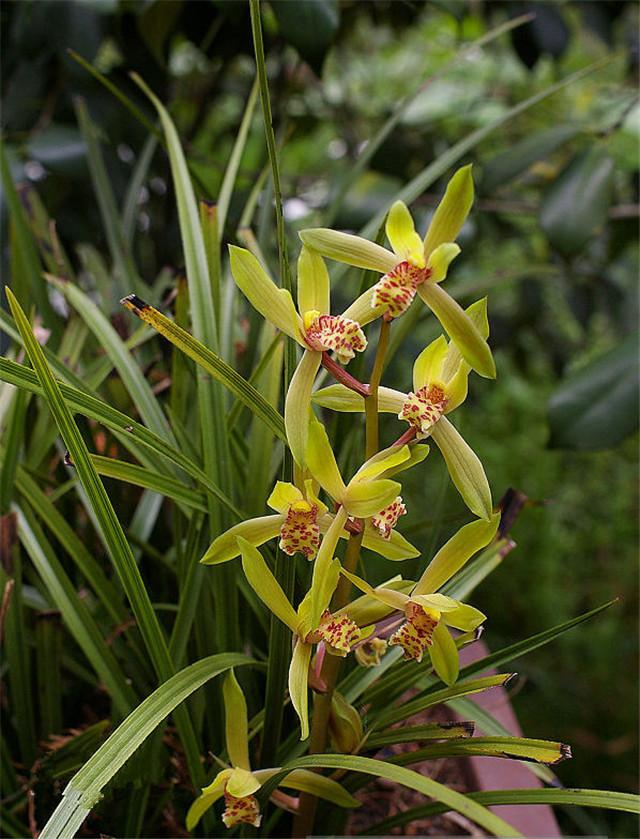
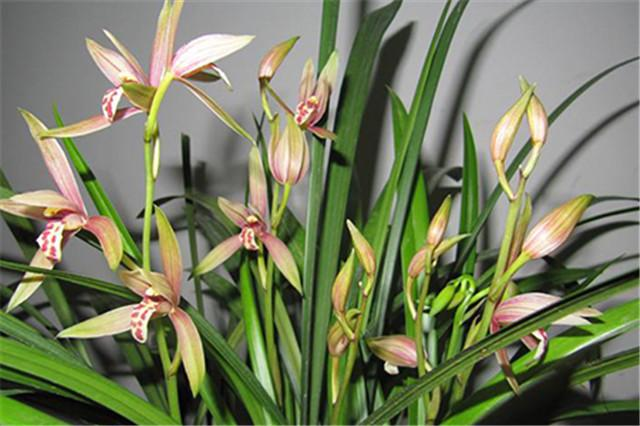
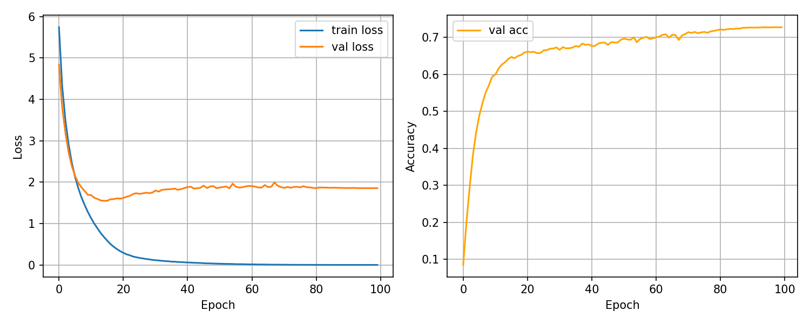
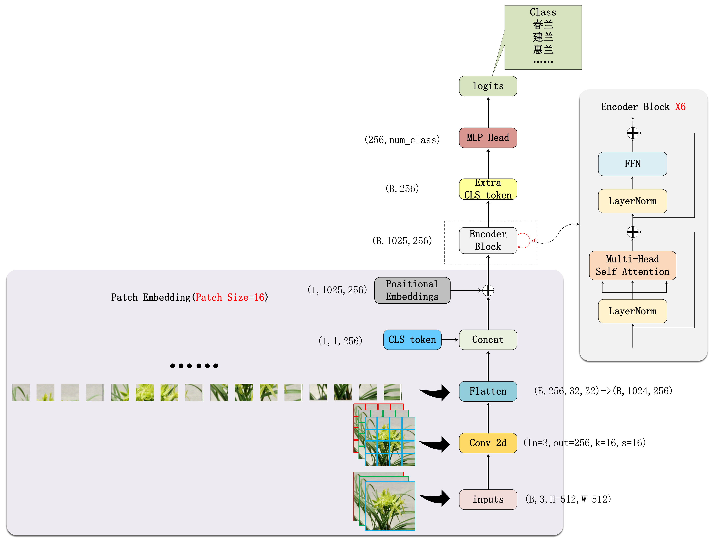
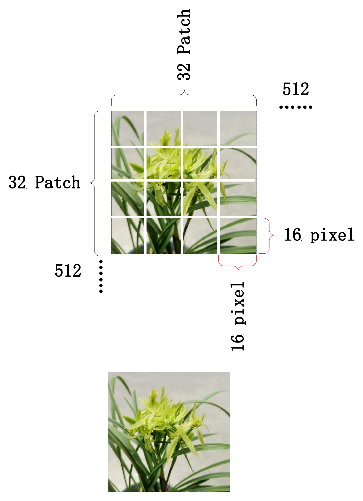
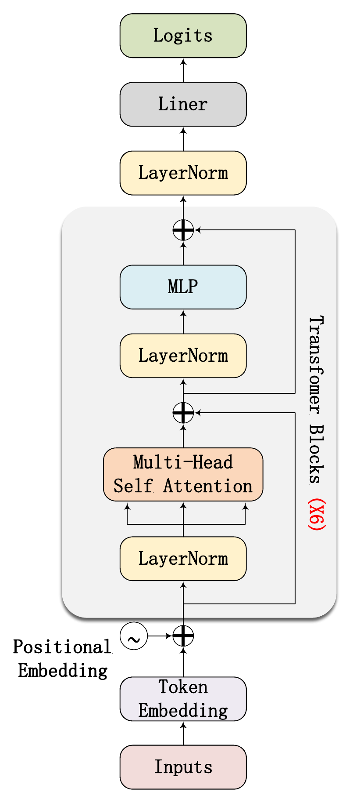

<div align="center">

# 🌸 中国兰花智能识别与描述生成系统

**China Orchid Classification and Analysis System**

基于 **Vision Transformer + LoRA + NanoGPT** 的课程设计：上传一张兰花图片，完成品种 Top-3 识别，并自动生成中文介绍。

[](https://www.python.org/)
[](https://pytorch.org/)
[](https://flask.palletsprojects.com/)
[](https://github.com/huggingface/peft)
[](#项目状态)

[功能亮点](#-功能亮点) · [快速开始](#-快速开始) · [模型架构](#-模型架构) · [项目结构](#-项目结构) · [路线图](#-路线图)

</div>

<p align="center">
  
  
</p>

## 💡 项目简介

传统植物识别系统通常只返回类别标签。本项目进一步把图像分类与自然语言生成串联起来，让系统既能识别兰花，也能输出面向普通用户的中文描述。

系统以 Orchid2024 数据集为基础，使用自定义 Vision Transformer 提取图像特征，通过 LoRA 适配分类模型；随后把预测得到的物种名与栽培品种名作为提示词交给轻量级字符级 NanoGPT，生成形态、观赏性和文化意象等描述。Flask Web 界面负责图片上传与结果展示。

> [!NOTE]
> 本仓库是深度学习课程设计，适合用于学习 ViT、参数高效微调、字符级语言模型以及 Flask 模型部署，不应直接用于科研鉴定、商业决策或濒危物种识别。

## ✨ 功能亮点

- **兰花品种识别**：输入单张图片，返回置信度最高的 3 个预测结果。
- **中英文品种信息**：关联物种、栽培品种及其中文名称。
- **自然语言描述**：NanoGPT 根据识别结果生成简短中文介绍。
- **参数高效微调**：以 LoRA 适配 `patch_emb` 与 `cls_linear`，降低训练参数量。
- **端到端 Web 演示**：支持点击或拖拽上传 JPG、PNG、JPEG、GIF 图片，单文件上限 16 MB。
- **训练过程可视化**：保存训练/验证损失、验证准确率和学习率变化。

## 📸 效果展示

当前 Web 界面会展示上传图片、Top-3 标签、中文物种名、中文栽培品种名、生成描述与置信度条。

<p align="center">
  
</p>

课程实验记录：ViT 使用约 9.4 万张训练图像，最佳验证准确率约为 **0.75+**。该数值来自课程报告中的一次训练，不代表严格复现实验；数据划分、随机种子与完整日志尚未随仓库发布。

## 🧠 模型架构


### Vision Transformer

<p align="center">
  <a href="assets/model-architecture.png">
    
  </a>
</p>

<p align="center"><sub>ViT 总体结构：图像经过 Patch Embedding、位置编码和 6 层 Encoder Block，最终由 CLS Token 完成类别预测（点击图片查看大图）。</sub></p>

<table>
  <tr>
    <td align="center" width="50%">
      <br />
      <sub>512×512 输入图像划分为 32×32 个 16×16 Patch</sub>
    </td>
    <td align="center" width="50%">
      <br />
      <sub>Transformer Encoder Block</sub>
    </td>
  </tr>
</table>

| 配置 | 数值 |
| --- | --- |
| 输入尺寸 | `512 × 512` |
| Patch 尺寸 | `16 × 16` |
| Patch 数量 | `32 × 32 = 1024` |
| Embedding 维度 | `256` |
| Transformer Encoder | `6` 层 |
| Attention Heads | `8` |
| 分类类别 | `1275`（以当前 `label2id.json` 为准） |
| LoRA | `r=16`，`alpha=32`，`dropout=0.05` |

#### 参数量计算

当前 1,275 类配置下，ViT 基础模型共有 **8,743,419（约 8.74M）** 个参数：

| 模块 | 计算方法 | 参数量 |
| --- | --- | ---: |
| Patch Conv | `256×3×16×16 + 256` | 196,864 |
| Patch Embedding | `256×256 + 256` | 65,792 |
| CLS Token | `1×1×256` | 256 |
| Position Embedding | `1025×256` | 262,400 |
| Transformer Encoder ×6 | `1,315,072×6` | 7,890,432 |
| Classification Head | `256×1275 + 1275` | 327,675 |
| **合计** |  | **8,743,419** |

LoRA 只作用于 `patch_emb` 和 `cls_linear`。对于一个 `Linear(in, out)` 层，LoRA 新增参数量为 `r×(in+out)`，因此：

```text
Patch Embedding: 16 × (256 + 256)  =  8,192
Classification:  16 × (256 + 1275) = 24,496
LoRA Total:                           32,688
```

加载 LoRA 后模型共有 **8,776,107** 个参数，其中仅 **32,688** 个 LoRA 参数需要训练，约占总参数量的 **0.37%**。

高清矢量版本见 [`模型结构图.pdf`](模型结构图.pdf)，NanoGPT 结构见 [`nanogpt.pdf`](nanogpt.pdf)。

### NanoGPT

NanoGPT 使用 Orchid2024 中的中文物种名和栽培品种名构造字符级语料，学习生成 20～80 字左右的兰花短描述。推理时以“物种名 + 品种名”作为上下文，自回归地产生后续文字。

## 🚀 快速开始

### 1. 克隆仓库

```bash
git clone https://github.com/Qinghe9/China-Orchid-Classification-and-Analysis-System.git
cd China-Orchid-Classification-and-Analysis-System
```

### 2. 创建环境并安装依赖

建议使用 Python 3.10，并根据自己的 CUDA 版本从 [PyTorch 官方安装页](https://pytorch.org/get-started/locally/) 安装 `torch` 与 `torchvision`。

```bash
python -m venv .venv

# Windows PowerShell
.\.venv\Scripts\Activate.ps1

# Linux / macOS
# source .venv/bin/activate

pip install -r requirements.txt
```

### 3. 准备数据与模型文件

完整运行需要下列未纳入当前 Git 仓库的大文件或源码：

```text
China-Orchid-Classification-and-Analysis-System/
├── best_model.pt                    # ViT 基础模型权重
├── Orchid2024/
│   ├── train/train.parquet
│   ├── validation/validation.parquet
│   └── test/test.parquet
└── GPT/
    ├── gpt_model.py                 # NanoGPT / GPTConfig 实现
    └── output/nanogpt_lan_final.pth # NanoGPT 权重
```

当前仓库已经包含 LoRA Adapter（`lora_weights/`），但 **LoRA 权重不能脱离匹配的 `best_model.pt` 单独运行**。请将你训练时保存的文件放到上述路径，或在代码中修改相应路径。

### 4. 启动 Web 应用

```bash
python app.py
```

浏览器访问 <http://127.0.0.1:5000>，上传一张清晰的兰花花朵图片即可查看结果。

### 5. 命令行推理

```bash
python inference.py "uploads/建兰.jpg"
```

## 🏋️ 训练模型

数据目录准备完成后，可运行当前 ViT 训练脚本：

```bash
python lora/train.py
```

默认配置为 512 像素输入、batch size 32、100 个 epoch、AdamW、Cosine Annealing，并启用 patience 为 10 的早停。训练完成后会生成 `best_model.pt` 与 `training_curve.png`。

> [!IMPORTANT]
> `lora/train.py` 当前实际执行的是 ViT 全量训练；`lora/lora.py` 才包含 LoRA 适配相关实现。开始长时间训练前，建议先检查脚本、数据字段和保存路径是否符合你的环境。

## 📂 项目结构

```text
.
├── app.py                    # Flask Web 入口
├── inference.py              # ViT + LoRA + NanoGPT 推理链路
├── vit.py                    # 自定义 Vision Transformer
├── dataset.py                # Orchid2024 Parquet 数据读取
├── dataset_infos.json        # 数据集字段与切分信息
├── requirements.txt          # Python 依赖
├── assets/                   # README 使用的模型结构图
├── templates/                # Web 上传页与结果页
├── lora/                     # 训练、LoRA 与批量推理脚本
├── lora_weights/             # LoRA Adapter 与标签映射
├── GPT/data/                 # NanoGPT 字符级训练语料
├── uploads/                  # 示例兰花图片
├── training_curve.png        # ViT 训练曲线
├── 模型结构图.pdf             # ViT 结构图
└── nanogpt.pdf               # NanoGPT 结构图
```

## 📊 数据集

项目使用 **Orchid2024**，原始数据以 Parquet 保存，主要字段如下：

| 字段 | 含义 |
| --- | --- |
| `Label` | 分类标签 |
| `Class_Name` | 类别名称/编号 |
| `Species_Name` | 英文物种名 |
| `Cultivar_Name` | 英文栽培品种名 |
| `Chinese_Species_Name` | 中文物种名 |
| `Chinese_Cultivar_Name` | 中文栽培品种名 |
| `Img.bytes` | 图像二进制数据 |

数据集不随本仓库分发。请自行确认数据来源、下载方式与授权范围，并保持 `train`、`validation`、`test` 三个切分的目录结构一致。

## ⚠️ 项目状态

这是一个仍在整理中的课程项目，当前公开版本存在以下限制：

- 缺少基础 ViT 权重、NanoGPT 源码与权重，克隆后不能直接完成端到端推理。
- 暂无可复现的评测脚本、混淆矩阵、随机种子和完整训练日志。
- NanoGPT 为小型字符级模型，可能出现重复、偏题或事实不准确的描述。
- 上传文件名尚未做安全清洗，Flask 以 debug 模式启动，仅适合本地演示。
- 项目暂未提供开源许可证；在添加许可证前，默认保留全部权利。

## 🗺️ 路线图

- [ ] 补充可下载的模型权重与校验值
- [ ] 补齐 NanoGPT 训练/模型源码
- [ ] 增加一键下载数据与模型的脚本
- [ ] 添加独立评测脚本、混淆矩阵和 Top-1 / Top-3 指标
- [ ] 重构历史注释代码并统一训练入口
- [ ] 为 Web 上传增加安全文件名、异常处理与生产部署配置
- [ ] 添加单元测试、CI 与 Docker 镜像
- [ ] 明确数据集、模型权重和源码许可证

## 🤝 参与贡献

欢迎通过 [Issues](https://github.com/Qinghe9/China-Orchid-Classification-and-Analysis-System/issues) 提交问题、改进建议或复现结果。如果你准备提交代码，请尽量在 Pull Request 中说明运行环境、修改目的和验证方式。

## 📚 致谢

- [PyTorch](https://github.com/pytorch/pytorch) — 深度学习框架
- [Hugging Face PEFT](https://github.com/huggingface/peft) — LoRA 参数高效微调
- [Flask](https://github.com/pallets/flask) — Web 应用框架
- [nanoGPT](https://github.com/karpathy/nanoGPT) — 轻量级 GPT 实现参考
- Orchid2024 数据集 — 兰花图像与品种元数据来源

---

<div align="center">
  如果这个课程项目对你有帮助，欢迎点一个 ⭐
</div>
